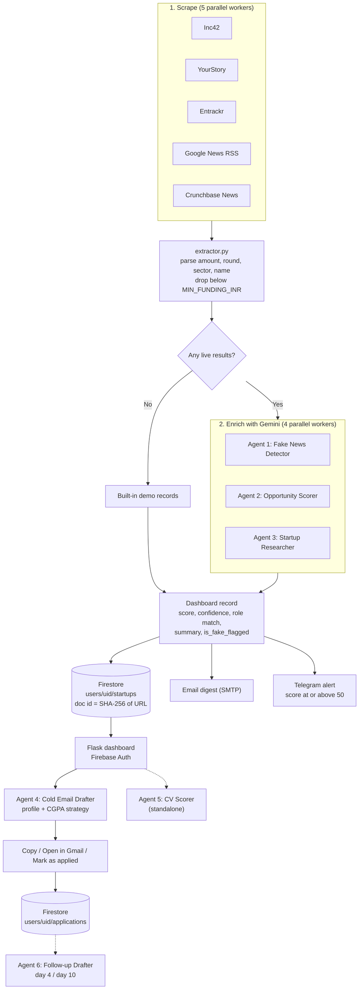

# FundedFirst

**Agentic AI for startup job discovery.** FundedFirst watches Indian startup funding news, filters out weak or unconfirmed stories, scores each company as an opportunity for a fresher, and drafts a personalised cold email, all from a web dashboard.

> Fresh funding means hiring. FundedFirst helps you reach the founders before the job post goes live.

---

## What it does

1. **Scrapes** five funding-news sources in parallel.
2. **Filters** to rounds of at least ₹1 Cr (configurable) and normalises amounts, round type, sector, and company name.
3. **Enriches** every startup with three Gemini agents: a credibility check, an opportunity score, and a plain-English summary.
4. **Stores** results per user in Firestore, de-duplicated by article URL.
5. **Alerts** you by email digest and optional Telegram ping for high scorers.
6. **Drafts** a cold email on demand, tuned to your profile, sector, and CGPA.
7. **Tracks** applications from the dashboard.

---

## Architecture



---

## The six agents

Every agent is a single-purpose function that sends a JSON-only prompt to **Google Gemini** through the `google-genai` SDK. All six use the same model, set by `GEMINI_MODEL` (default **`gemini-2.0-flash`**), with a 500-token output cap. Each one validates and clamps the model's JSON, and each has a safe fallback, so the pipeline keeps running if Gemini is missing or errors out.

| # | Agent | File | LLM | What it does | Output |
|---|-------|------|-----|--------------|--------|
| 1 | **Fake News Detector** | `agents/fake_news_detector.py` | Gemini (`GEMINI_MODEL`) | Judges whether a funding article is credible. Looks for "reportedly" / "in talks" language, missing investor names, oversized seed rounds, press-release tone, and suspiciously round amounts. Uses only the supplied article text. | `credibility` (HIGH/MEDIUM/LOW), `is_confirmed`, `red_flags`, `recommendation` (APPLY/VERIFY_FIRST/SKIP) |
| 2 | **Opportunity Scorer** | `agents/scorer.py` | Gemini (`GEMINI_MODEL`) | Scores a funded startup 0–100 as an opportunity for a fresher, favouring recent, credible, hiring-likely companies. | `score`, `confidence`, `role_match`, `reason` |
| 3 | **Startup Researcher** | `agents/researcher.py` | Gemini (`GEMINI_MODEL`) | Summarises what the company does and why to apply now, strictly from the article text. Returns "Unknown" rather than guessing. | `what_they_do`, `why_apply_now` (≤140 chars each) |
| 4 | **Cold Email Drafter** | `agents/email_drafter.py` | Gemini (`GEMINI_MODEL`) | Writes a human-sounding cold email (under 180 words) to a founder or CTO, referencing 1–2 matching skills or projects. Follows a CGPA strategy (see below). Falls back to a template email if Gemini is unavailable. | `subject`, `body`, `tone`, `generated_with_ai` |
| 5 | **CV Scorer** | `agents/cv_scorer.py` | Gemini (`GEMINI_MODEL`) | Acts as a recruiter reviewing a fresher's CV against a target sector. Extracts PDF text (PyMuPDF, then PyPDF2) and accepts local paths, URLs, and Google Drive links. Weights: skills 40%, projects and experience 35%, academics 25%. | `cv_score`, `grade`, sub-scores, `top_strengths`, `critical_improvements`, `missing_skills`, `hiring_verdict` |
| 6 | **Follow-up Drafter** | `utils/follow_up.py` | Gemini (`GEMINI_MODEL`) | Writes a short (80–120 word) follow-up to a startup you already emailed: a gentle check-in around day 4, a final nudge around day 10. | follow-up email body |

### Supporting logic (not LLM agents)

- **Profile matcher** (`profiles/`): maps a startup's sector to one of three role profiles: *Backend* (FinTech, SaaS, B2B, Logistics, PropTech), *ML/Data* (AI, HealthTech), or *Full-stack/Fresher* (EdTech, D2C, AgriTech, CleanTech, and unknown).
- **CGPA strategy** (`utils/cgpa_handler.py`): 8.0 and above is mentioned confidently, 7.0–7.9 briefly, 6.0–6.9 skipped in favour of projects, and below 6.0 never mentioned.
- **Confidence badges** (`utils/confidence.py`): turns HIGH/MEDIUM/LOW into readable labels for the digest.

---

## Features

**Discovery**
- Five-source scraping: Inc42, YourStory, Entrackr, Google News RSS, Crunchbase News
- Funding-threshold filter (default ₹1 Cr) with USD to INR conversion
- Roundup and weekly-report headlines are skipped to avoid junk company names
- Built-in demo records when live scraping returns nothing (handy for demos)

**Dashboard** (`templates/dashboard.html`)
- Google sign-in via Firebase Auth
- Pages: Dashboard (top matches, all startups, application history), Startups, History, Settings
- Sector filter chips, score and confidence badges, "Run Pipeline" button with live status
- Apply modal: AI-drafted email with **Copy**, **Open in Gmail**, and **Mark as Applied**
- Profile editor (degree, CGPA, year, skills, experience, links, target role, notice period, expected CTC) and CV upload (PDF, DOC, DOCX)

**Outreach and alerts**
- HTML and plain-text email digest, ranked by score
- Optional Telegram alerts for startups scoring at or above `ALERT_SCORE_THRESHOLD`
- Error-alert emails if the pipeline or scheduler fails
- Daily scheduler (`run_scheduler.py`, default 08:00)

**Multi-user by design**
- Each user's startups, profile, and applications live under `users/{uid}` in Firestore
- Every `/api/*` route (except status and Firebase config) requires a verified Firebase ID token

---

## Project structure

```text
FundedFirst/
├── app.py                  # Flask app + REST API + dashboard host
├── main.py                 # Pipeline orchestrator + CLI entrypoint
├── run_scheduler.py        # Daily scheduled pipeline run
├── apply_to_startups.py    # Interactive CLI apply flow
├── config.py               # Env loading, thresholds, scraper URLs
├── database.py             # Firebase Admin: auth verification + Firestore
├── extractor.py            # Amount / round / sector / name parsing
├── email_sender.py         # Digest, alert, and attachment emails (SMTP)
├── agents/
│   ├── fake_news_detector.py
│   ├── scorer.py
│   ├── researcher.py
│   ├── email_drafter.py
│   └── cv_scorer.py
├── scrapers/               # base + inc42, yourstory, entrackr, google_news, crunchbase
├── profiles/               # profile manager + sector matcher
├── utils/                  # cgpa_handler, confidence, follow_up
├── templates/dashboard.html
└── test_cv_scorer.py       # Run the CV scorer on its own
```

---

## API

| Route | Method | Purpose |
|-------|--------|---------|
| `/api/firebase-config` | GET | Web config for client-side Firebase Auth |
| `/api/auth/verify` | POST | Verify ID token, create profile on first sign-in |
| `/api/profile` | GET / PUT | Read or update profile |
| `/api/profile/cv` | POST | Upload CV (PDF/DOC/DOCX) |
| `/api/startups` | GET | User's startups, sorted by score |
| `/api/run` | POST | Start the pipeline in a background thread |
| `/api/status` | GET | Pipeline status |
| `/api/apply` | POST | Draft a cold email for a startup |
| `/api/mark-applied` | POST | Record an application |
| `/api/applications`, `/api/history` | GET | Application history and score summary |

---

## Setup

### 1. Install

```bash
git clone https://github.com/Aarushiptl31/FundedFirst.git
cd FundedFirst
pip install -r requirements.txt
```

### 2. Firebase

1. In the [Firebase Console](https://console.firebase.google.com), create a project.
2. **Build → Authentication:** enable Google (and/or Email/Password).
3. **Build → Firestore Database:** create a database (test mode for local dev; tighten rules before deploying).
4. **Project settings → Service accounts → Generate new private key.** Save it as `firebase_credentials.json` in the project root (git-ignored).
5. **Project settings → General → Your apps:** create a Web app and copy its config values into `.env`.

### 3. Gemini

Create a key at [aistudio.google.com](https://aistudio.google.com) and set `GEMINI_API_KEY`.

### 4. Configure `.env`

Copy `.env.example` to `.env` and fill it in:

```env
# Gemini
GEMINI_API_KEY=
GEMINI_MODEL=gemini-2.0-flash

# Firebase
FIREBASE_CREDENTIALS_PATH=firebase_credentials.json
FIREBASE_WEB_API_KEY=
FIREBASE_AUTH_DOMAIN=
FIREBASE_PROJECT_ID=
FIREBASE_STORAGE_BUCKET=
FIREBASE_MESSAGING_SENDER_ID=
FIREBASE_APP_ID=

# Email digest (Gmail app password)
EMAIL_USER=
EMAIL_PASSWORD=
RECIPIENT_EMAIL=
EMAIL_SMTP=smtp.gmail.com
EMAIL_PORT=587

# Optional
FLASK_SECRET_KEY=
TELEGRAM_BOT_TOKEN=
TELEGRAM_CHAT_ID=
MIN_FUNDING_INR=10000000      # ₹1 Cr
ALERT_SCORE_THRESHOLD=50
HIGH_SCORE_THRESHOLD=30
SCHEDULER_TIME=08:00
```

---

## Run

```bash
python app.py                      # web dashboard at http://localhost:5000
python main.py --pipeline          # run the scrape + enrich pipeline once
python main.py --pipeline --no-email
python main.py --digest-only --days 7   # email a digest from stored data
python main.py --demo              # send a demo digest (no scraping, no AI)
python main.py --followups         # draft follow-ups for pending applications
python run_scheduler.py            # run daily at SCHEDULER_TIME
python test_cv_scorer.py --cv path/to/cv.pdf --sector FinTech
```

---

## Current status

- Agents 1–3 run automatically on every scraped startup. Agent 4 runs when you click **Apply Now**.
- The **CV Scorer** is currently a standalone tool (`test_cv_scorer.py`); it is not yet called from the dashboard or pipeline.
- The **Follow-up Drafter** is wired to `--followups`, but pending follow-ups are not yet tracked in the multi-user Firestore model, so it has nothing to draft until that is hooked up.
- The credibility result is stored as an `is_fake_flagged` flag; the `recommendation` field is not yet surfaced in the UI.

## Security notes

`.env`, `firebase_credentials.json`, logs, and uploaded CVs are git-ignored. Never commit them. Use restrictive Firestore rules and a fixed `FLASK_SECRET_KEY` before deploying beyond local development.
